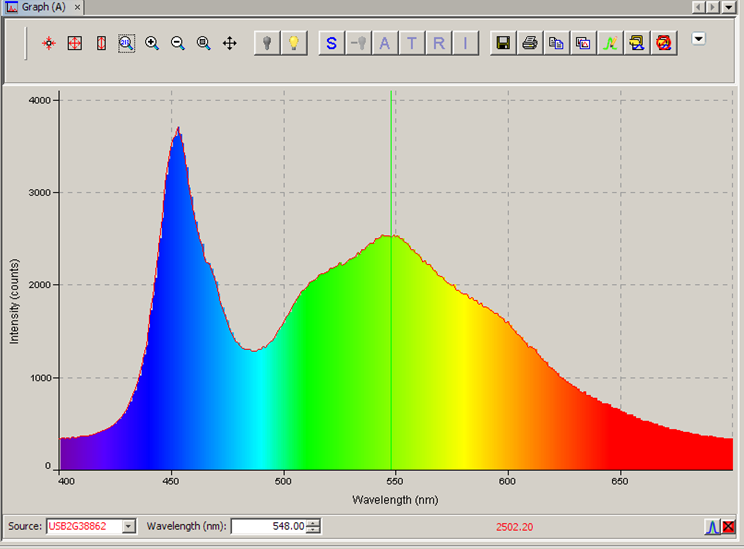

# Physical Instrumentation

Experimental measurement reports and MATLAB modelling exercises covering spectroscopy, electrical characterization, inkjet sensor fabrication and quantum confinement.

*Cold-white LED spectrum extracted unchanged from the original [spectrophotometry report](docs/tp3_mesures_sous_pointes_spectrophotometrie.docx).*

## Repository guide

| Area | Material |
| --- | --- |
| [Measurement reports](docs/) | Probe-based measurements, spectrophotometry and NMR spectroscopy |
| [Inkjet sensor fabrication](studies/inkjet_sensor_fabrication/) | Dimatix preparation, drop observation and printed-pattern parameter study |
| [Quantum-well studies](studies/quantum_well/) | MATLAB models, including the finite-difference exercise relocated from Divers_TP |
| [Historical report](archive/biosensing_original/) | Original biosensing document retained with its provenance |

## Technical focus

The laboratory reports document measurement methods and interpretation of physical observations. The quantum-well scripts provide a separate numerical study of confinement; they do not acquire measurements from instruments.

The finite-difference exercise has its own source and guide under `studies/quantum_well/finite_difference/`. It is kept separate from `tp_physqiue_quantique.m` because these are distinct source variants.

## Inkjet sensor fabrication

The [Dimatix laboratory guide](studies/inkjet_sensor_fabrication/README.md) links the original 21-page report and explains cartridge preparation, drop observation, vector pattern creation and the influence of drop spacing on pattern continuity. This is a fabrication-process study, complementing the electrical characterization work in Instrumentation Capteurs.

## Use

Read the relevant laboratory report for the experimental setup and measurement conditions. Open the quantum-well scripts in MATLAB, review their parameters and run each study independently.

For resistance-temperature curves and electrical sensor conditioning, see [Instrumentation Capteurs](https://github.com/tedjelmoulksn-dotcom/Instrumentation_Capteurs). The biosensing project is documented separately in [Bio capteur](https://github.com/tedjelmoulksn-dotcom/Bio_capteur).

Original laboratory documents retain their original language; the repository navigation and explanations are in English.
